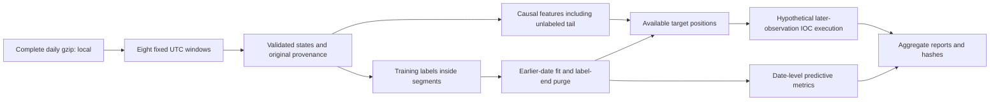

# Applicant and reviewer guide

This is a research-engineering project with a completed original study and a
broader spot extension. The historical experiment and its independent clean
reproduction are complete, with exact metric and simulation-hash agreement.
Use the [research account](research-report.md), [validation record](../../reports/extension/validation.json)
and [milestone index](milestones.md) for the result and final delivery evidence.
The precision criterion remains unmet; this is exploratory predictive evidence,
and the declared trading policies lose under the hypothetical assumptions.
Building the software with assistance does not by itself
establish the applicant's ability to explain, modify or independently validate
it. The exercises below are work for the applicant to perform, not achievements
claimed on their behalf.

## A five-minute reviewer route

1. Read the [preregistered protocol](preregistered-study.md) and
   [research design](research-design.md): what question, margin, split and
   stopping rule were fixed before scores?
2. Inspect [source evidence](data-source-evidence.md) and the
   [source lock](../../data/extension-sources.lock.json): why is the instrument
   spot, what is sampled, and how are original rows traced?
3. Run the offline synthetic demo from the [README](../../README.md). Read its
   report as a demonstration of software behavior, not a market result.
4. Inspect the separate classification and execution sections of the
   [published reference](../../reports/extension/reference/report.html). A predictive gain, hypothetical P&L and engineering
   acceptance are three different conclusions.
5. Check the source/config/data identities, independent review, clean-checkout
   reproduction and benchmark evidence before repeating a portfolio claim.

The aggregate deliverables are reports/extension/reference/ with experiment.json,
report.html and report.md, reports/extension/pilot/experiment.json, the independent
reproduction proof, measured benchmarks and reports/extension/validation.json.
Review memos belong under docs/extension/reviews/. Read their actual status
rather than assuming software checks establish a predictive or trading edge.

## What the system does

The primary comparison is **full-book logistic regression minus history-only
logistic regression** on date-mean macro F1. Both use the same eligible
observations and train-only transformations. Boosted trees versus full-book
logistic is secondary; the majority rule is descriptive. A ten-state horizon
has variable elapsed time. An exact +0.01 or -0.01 USD midpoint change is
unchanged; only a larger absolute change is directional.

2021 supplies initial training, 2022 supplies twelve development dates, and
2023-2024 supplies twenty-four final dates. Final evaluation is prequential:
the fixed schedule refits before each date using strictly earlier labels,
including previous final dates. This is a declared expanding evaluation, not
one model held unchanged for two years. Intermediate final results must not
alter settings or stopping.

Detailed historical signals, orders, fills and ledgers remain local. The report
exports aggregate metrics and hashes. The acquisition/storage modules preserve
full-source row positions despite removing hours between selected windows.
Window, invalid-state and gap boundaries reset features, targets and execution.

Useful implementation entry points are
[acquisition.py](../../src/market_microstructure/extension/acquisition.py),
[storage.py](../../src/market_microstructure/extension/storage.py),
[study.py](../../src/market_microstructure/extension/study.py),
[statistics.py](../../src/market_microstructure/extension/statistics.py),
[simulation.py](../../src/market_microstructure/extension/simulation.py) and
[cli.py](../../src/market_microstructure/extension/cli.py).

## Two defects corrected before new historical fitting

The spot extension exposed a numerical boundary problem: binary floating-point
subtraction can make an exact one-cent move appear slightly larger than one
cent. The extension uses validated integer price ticks and half-tick midpoint
units so exact threshold contact remains unchanged. The original frozen study
is preserved, rather than silently rewritten after seeing its scores.

A separate causality defect came from using a frame that retained only rows
with an available future training label to generate execution signals. That
would remove the last ten decisions before a future endpoint or gap, granting
the policy information about future label availability. The corrected signal
path uses a label-free causal feature frame, including the unlabeled tail after
warm-up. Synthetic tests alter or truncate later observations and check that
earlier signals remain unchanged. These fixes preceded new historical fitting;
they were not discovered by selecting a more favorable backtest result.

The evidence is in [research tests](../../tests/test_extension_research.py).
An applicant should be able to reproduce each failure on a tiny independent
fixture and explain why the corrected behavior follows from the information
available at the decision time.

## Interpreting uncertainty and hypothetical execution

The practical margin is 0.01 macro F1. The paired date-block bootstrap uses
length-three chronological blocks, 2,000 resamples, seed 42 and a 95% interval.
A lower bound above +0.01 supports the declared gain under those assumptions;
an upper bound below +0.01 rules out that gain. Equivalence requires the entire
interval inside [-0.01,+0.01]. The precision plan targets half-width at most
0.015. An inadequate interval must remain inconclusive about the intended
precision; it must not be advertised as a powered negative result.

Adjacent observed months are not proven exchangeable, and expanding fits share
training data. Many correlated book updates are not many independent trials.
The sampled windows total two selected hours per date; missing hours are not
interpolated into a continuous backtest or investable equity curve.

The simulator models unlevered long/flat spot with marketable IOC orders.
A new order cannot fill on its originating observation, even at zero configured
action delay. Observed depth limits fills; remainders cancel. Fees, slippage and
delays are declared scenarios, not verified historical account costs or measured
system latency. Segment-end inventory is marked at observed bid and remains
unresolved. Equal-capital segments are independent trials; their aggregate
does not imply compounding or annualized Sharpe. Top-five snapshots cannot
establish queue priority, hidden liquidity, market impact or actual exchange fills.

## Published-method adaptation

Gould and Bonart's
[Queue Imbalance as a One-Tick-Ahead Price Predictor in a Limit Order Book](https://arxiv.org/abs/1512.03492)
examines queue imbalance and the next midpoint direction using logistic models
on ten Nasdaq stocks. The extension separately adapts that idea to its crypto
data on development dates only. It compares queue logistic probabilities with
a training-frequency prior and a constant 0.5 null, reporting Brier score, log
loss and ROC AUC where defined.

The market/data, sampling, chronology and regularization differ. A decision is
made at the first observed state of each constant-midpoint run; the next
nonzero move labels that decision inside the same segment. The code does not
claim to reproduce the paper's numerical tables, original dataset, randomized
split or local-logistic variant. Explain this as a **methodological adaptation**.

## Independent exercises before an interview

- Trace one synthetic observation through normalization, a causal feature,
  a future label, the purge boundary, a signal and a later execution event.
  Identify the units and latest information time at every step.
- Construct exact one-cent and one-and-a-half-cent midpoint moves. Derive the
  expected classes independently, then compare with the regression tests.
- Remove future rows from a synthetic segment and explain which prior signals
  must remain unchanged, which final labels disappear and which inventory stays
  unresolved. Do not use an unseen endpoint to force a profitable liquidation.
- Explain the difference between a training-majority baseline, history-only
  logistic and full-book logistic. Describe what a failed imbalance ablation
  can and cannot establish about causality.
- Read a date-block interval and classify the declared practical-gain,
  equivalence and precision decisions without relying on whether a point
  estimate is positive. State the dependence assumptions aloud.
- Run a frozen reproduction in your own checkout and permitted data environment.
  Change one setting in a separate experimental branch and predict which
  provenance check should fail before fitting; do not consume the reserved
  final dates to search for an improvement.
- Explain a benchmark's input size, timing boundary, native memory measure and
  ledger parity check. Do not call synthetic throughput production exchange
  latency or claim C++ acceleration that was not implemented and measured.

Portfolio statements should match completed evidence and work the applicant
can explain. Disclose material assistance honestly. Do not claim personal
competence, exact paper reproduction, live trading experience or profitable
execution merely because the repository contains generated code and reports.

## Sharing and original-study reproduction

The [provider terms](https://docs.tardis.dev/legal/terms-of-service) restrict
historical data and trained-asset sharing. Private GitHub access is access to
this code and permitted aggregates; it is not a provider-data license. An
external reviewer obtains their own permitted data and runs the local tool.
Do not send historical event rows, signals, ledgers, fitted transformations
or model assets through repository attachments or publish a hosted
data-backed analytics service.

The original 2020 reference uses frozen v1 source revision **2ebb818**. Its
exact verification/reproduction must run in the separate worktree described
in [the README](../../README.md). Current extension modules change the executable
source fingerprint, even while the original files and result artifacts remain
unchanged. The two studies have separate sources, contracts and empirical claims.
